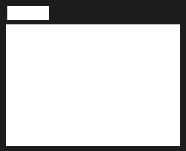

# Mouse Battery Bar

[简体中文](README.md) · **English**

Build a lightweight **macOS menu bar battery indicator** for your own wireless mouse. It reads battery data through native macOS interfaces without installing the manufacturer's driver. Give the prompt below to a coding assistant that can run commands on your Mac to build an app for your model.

By default, the app samples every five minutes, releases the receiver after each reading, and pauses its timer while the display sleeps. A local build uses only system frameworks. The published VT9PRO edition also includes Sparkle for updates.



Example VT9PRO menu, rendered from a recorded 53% battery report.

## Copy this prompt into your AI assistant

Replace the bracketed text with your device details. If you're unsure, enter “unknown” and let the assistant identify the connected device.

```text
Use the GitHub template capton586/mouse-battery-bar
https://github.com/capton586/mouse-battery-bar
to build a macOS menu bar battery app for my [brand and full model] connected via [Bluetooth / USB receiver / unknown].

Open or clone that repository, read docs/adapt.en.md, identify my mouse, and verify one fresh battery
reading from that specific device. Build for this mouse using native macOS interfaces without a vendor driver.
Keep device-specific logic in src/MouseProfile.m, the five-minute default interval, and the time of the last
successful reading. Run scripts/dmg.sh to build the .app and package that same app in a personal .dmg. Deliver both, the source, and reproducible commands.
Install the app from the DMG into Applications, launch it there, and verify a fresh battery reading in its menu.
If the mouse exposes no verifiable battery data, tell me where verification stopped.
```

## Build and run

On macOS 13 or later, install Apple's Command Line Tools (`xcode-select --install`) and run these commands from the repository directory.

```sh
./scripts/dmg.sh
```

The script produces **Mouse Battery Bar.app** and **MouseBatteryBar-VERSION.dmg** in `build/`. Open the DMG, drag the app into Applications, eject the image, then launch the installed app. Choose Refresh from the mouse menu and check for a battery percentage with a new reading time.

If access is denied, allow the installed **Mouse Battery Bar** in **System Settings → Privacy & Security → Input Monitoring**, then quit and reopen it. The terminal or an older build may have a separate permission. If secure input is active, finish entering your password, leave the password field, wake the mouse and refresh. If sampling fails, the menu bar keeps the last successful percentage, including after a restart. Open the menu to see its timestamp and the current error. A dash means the app has never saved a reading.

For diagnostics, run `"/Applications/Mouse Battery Bar.app/Contents/MacOS/MouseBatteryBar" --print` for one sample, or use `--status` to include DPI when available. Verify installation with a fresh reading in the menu bar.

## Example and releases

The included reader has been tested with a Rapoo VT9PRO USB receiver (`24AE:185A`). Other mice need a verified source of battery data. The [GitHub Releases page](https://github.com/capton586/mouse-battery-bar/releases) includes the template source and a model-specific installer named `MouseBatteryBar-VT9PRO-<version>.dmg`. If your receiver matches, install the DMG once. In its mouse menu choose **检查更新…** (Check for Updates). Automatic checks run about once a day while the app is running. Automatic checks and downloads each have a menu toggle. Sparkle verifies signed updates and handles installation and relaunch. Local builds use the AI workflow below.

## Update your customized app with AI

```text
Update my existing macOS mouse battery app using the latest stable release of
capton586/mouse-battery-bar at https://github.com/capton586/mouse-battery-bar.
My local project is [path or fork URL] and my mouse is [full model and connection].
Identify the current upstream base and fetch the latest release. Show the version change.
Merge applicable changes while preserving local edits, src/MouseProfile.m, bundle ID,
preferences, and my existing update channel. Keep the VT9PRO feed exclusive to its own build.
Run scripts/dmg.sh for my profile and deliver the updated .app and the personal .dmg containing it.
Install from that DMG, launch from Applications, and verify a fresh reading and its timestamp.
If sampling fails, verify that the previous successful percentage and timestamp survive.
Report the upstream tag, output paths, and what you verified.
```

[Publishing signed VT9PRO updates](docs/vt9pro-release.md)

[Use this template](https://github.com/capton586/mouse-battery-bar/generate) · [Adaptation guide](docs/adapt.en.md) · [MIT license](LICENSE)
