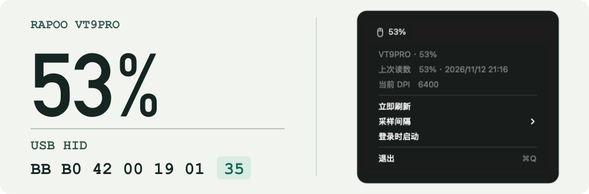

# Mouse Battery Bar

**English** · [简体中文](README.zh-CN.md)

See your wireless mouse’s battery percentage in the **macOS menu bar**. Use this lightweight template to build an app for your own model with a coding assistant. It reads battery data through native macOS interfaces and needs no vendor driver.

**[Build for my mouse with AI](#build-for-your-mouse-with-ai)** · **[Install the Rapoo VT9PRO edition](#install-the-rapoo-vt9pro-edition)**

<picture>
  <source media="(prefers-color-scheme: dark)" srcset="assets/readme/hero-dark.svg">
  
</picture>

The VT9PRO preview uses a recorded battery report. Open the menu to see when the mouse last reported its charge. If a sample fails, the previous percentage and its timestamp survive even after an app restart. A dash means the app is still waiting for its first reading.

## Build for your mouse with AI

Replace the brackets and paste this prompt into a coding assistant that can run commands on your Mac. If you’re unsure of the model or connection, enter “unknown”.

```text
Use the macOS template capton586/mouse-battery-bar at
https://github.com/capton586/mouse-battery-bar to build a menu bar battery app for my
[brand and full model], connected via [Bluetooth / USB receiver / unknown].

Read docs/adapt.en.md. Identify my device and verify one fresh battery reading from it.
Use native macOS interfaces without a vendor driver. Keep the reader in src/MouseProfile.m,
give my build its own bundle ID, and keep the five-minute interval and last successful reading.
Run scripts/dmg.sh. Deliver the .app, a personal .dmg containing that same app, the source,
and the commands to reproduce the build. Install from the DMG, launch from Applications,
and confirm the menu shows a fresh reading and timestamp. If the device exposes no verifiable
battery value, explain what you checked and where verification stopped.
```

[Create a repository from this template](https://github.com/capton586/mouse-battery-bar/generate) · [Device adaptation guide](docs/adapt.en.md)

## Install the Rapoo VT9PRO edition

The prebuilt DMG is for the **Rapoo VT9PRO with USB receiver `24AE:185A`** on macOS 13 or later. It supports Apple silicon and Intel Macs.

1. Open [GitHub Releases](https://github.com/capton586/mouse-battery-bar/releases) and download the asset named `MouseBatteryBar-VT9PRO-<version>.dmg`.
2. Open the DMG, drag **Mouse Battery Bar.app** into **Applications**, eject the DMG, then launch the installed app.
3. Wake the mouse and choose **立即刷新** (Refresh) from the mouse menu. Check that the reading time advances.

The menu offers 5, 10, 15 and 30-minute sampling intervals and a launch-at-login switch. The default is five minutes. The app releases the receiver after each sample and pauses scheduled reads while the display sleeps.

For updates, choose **检查更新…** (Check for Updates). The VT9PRO edition uses Sparkle to verify signed updates, checks about once a day while running, and offers separate toggles for automatic checks and downloads. Local template builds use only system frameworks.

<a name="让-ai-更新已有的个人版本"></a>

## Update your customized app with AI

```text
Update my existing macOS mouse battery app using the latest stable release of
capton586/mouse-battery-bar at https://github.com/capton586/mouse-battery-bar.
My project is [local path or fork URL]. My mouse is [full model and connection].

Identify my upstream base and the latest stable tag. Merge applicable changes, preserving
my local edits, src/MouseProfile.m, bundle ID, saved preferences and existing update channel.
Keep the upstream VT9PRO feed exclusive to its own edition. Run scripts/dmg.sh, deliver the
updated .app and the personal .dmg containing it, then install from that DMG and launch
from Applications. Verify a fresh reading and timestamp. Check that a failed sample keeps
the previous value and time. Report the version change, output paths and verification results.
```

## Build from source

On macOS 13 or later, install Apple’s Command Line Tools with `xcode-select --install` if needed. Once your reader is ready, run this from the repository root.

```sh
./scripts/dmg.sh
```

You’ll find `Mouse Battery Bar.app` and `MouseBatteryBar-<version>.dmg` in `build/`. Install the app from the DMG and verify a new reading in the menu.

## When the reading stops updating

| What you see | What to do |
| --- | --- |
| The percentage stays the same | Open the menu and check the **last reading time**. A new time with the same percentage is a successful sample. If the time is old, check the status line. |
| Input Monitoring is denied, or the terminal reads a value but the menu cannot | In **System Settings → Privacy & Security → Input Monitoring**, allow the copy in **Applications**. After an upgrade, if it is already enabled, remove the old entry and add the installed app again. Quit, reopen and choose **立即刷新**. The VT9PRO battery report shares a receiver interface with a keyboard collection. |
| Secure Input is active, or the receiver times out | Finish entering your password and leave the password field if applicable. Move the mouse to wake it, then choose **立即刷新**. |

To read one sample in Terminal, run the installed executable. Use `--print` for the percentage alone or `--status` to include DPI when the reader supports it.

```sh
"/Applications/Mouse Battery Bar.app/Contents/MacOS/MouseBatteryBar" --status
```

[Roadmap and hardware verification (Chinese)](docs/roadmap.md) · [Publishing signed VT9PRO updates](docs/vt9pro-release.md) · [MIT license](LICENSE)
