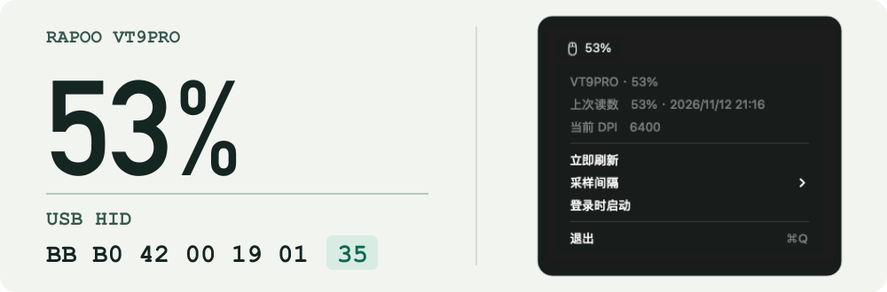

# Mouse Battery Bar

[English](README.md) · **简体中文**

在 **macOS 菜单栏**查看无线鼠标电量。把这份轻量模板交给能在 Mac 上运行命令的 AI，就能为自己的鼠标构建应用。应用通过 macOS 原生接口读取电量，无需厂商驱动。

**[用 AI 为我的鼠标构建](#用-ai-为自己的鼠标构建)** · **[安装雷柏 VT9PRO 专版](#安装雷柏-vt9pro-专版)**

<picture>
  <source media="(prefers-color-scheme: dark)" srcset="assets/readme/hero-dark.svg">
  
</picture>

图中使用了 VT9PRO 实机记录的电量报告。点开菜单可以看到上次成功读取的时间。采样失败时，菜单栏保留上次电量和原来的时间，重启应用后也能看到。首次成功采样前显示「—」。

## 用 AI 为自己的鼠标构建

替换方括号里的内容，把提示词复制给能在你 Mac 上运行命令的 AI。型号或连接方式不清楚时可以填「未知」。

```text
请使用 macOS 模板 capton586/mouse-battery-bar
https://github.com/capton586/mouse-battery-bar
为我的 [品牌和完整型号] 构建菜单栏电量应用。连接方式是 [蓝牙 / USB 接收器 / 未知]。

阅读 docs/adapt.md，识别我的鼠标，验证一次确实来自它的新电量读数。
使用 macOS 原生接口，无需厂商驱动。把读取器放在 src/MouseProfile.m，使用独立的 bundle ID，
保留默认 5 分钟采样和上次成功读数。运行 scripts/dmg.sh，交付 .app、包含同一份应用的个人 .dmg、
源码和复现命令。从 DMG 安装到「应用程序」并启动，确认菜单显示新的电量读数和时间。
若设备没有上报可验证的电量，请说明检查了什么、卡在哪一步。
```

[用此模板创建仓库](https://github.com/capton586/mouse-battery-bar/generate) · [鼠标适配指南](docs/adapt.md)

## 安装雷柏 VT9PRO 专版

预构建的 DMG 适用于 **雷柏 VT9PRO 和 USB 接收器 `24AE:185A`**，支持 macOS 13 或更高版本的 Apple 芯片及 Intel Mac。

1. 打开 [GitHub Releases](https://github.com/capton586/mouse-battery-bar/releases)，下载名为 `MouseBatteryBar-VT9PRO-版本号.dmg` 的附件。
2. 打开 DMG，把 **Mouse Battery Bar.app** 拖入「应用程序」。推出 DMG，再从「应用程序」启动。
3. 移动鼠标唤醒设备，点开菜单栏鼠标图标，选择**立即刷新**，确认读数时间已经更新。

菜单里可以开启「登录时启动」，也可以选择 5、10、15 或 30 分钟的采样间隔。默认每 5 分钟采样一次，读完即释放接收器，屏幕休眠时暂停定时采样。

需要升级时，在菜单中点**检查更新…**。VT9PRO 专版使用 Sparkle 验证更新签名，运行时默认约每天检查一次，可分别开关自动检查和自动下载。本地适配版只依赖系统框架。

## 让 AI 更新已有的个人版本

```text
请用 capton586/mouse-battery-bar 最新稳定版升级我已有的 macOS 鼠标电量应用。
上游仓库 https://github.com/capton586/mouse-battery-bar
我的项目在 [本地路径或 fork 地址]，鼠标是 [完整型号和连接方式]。

确认当前基于哪个上游版本并取得最新稳定标签。合并适用改动，保留本地修改、src/MouseProfile.m、
bundle ID、偏好设置和已有更新渠道。仅上游的 VT9PRO 专版使用其更新源。
运行 scripts/dmg.sh，交付更新后的 .app 和包含它的个人 .dmg。从 DMG 安装到「应用程序」并启动，
验证新的电量和读数时间。验证采样失败时保留上次的电量和时间。反馈升级前后版本、产物路径和验证结果。
```

## 从源码构建

需要 macOS 13 或更高版本。若尚未安装 Apple Command Line Tools，先运行 `xcode-select --install`。完成鼠标适配后，在仓库根目录执行：

```sh
./scripts/dmg.sh
```

`build/` 中会生成 `Mouse Battery Bar.app` 和 `MouseBatteryBar-版本号.dmg`。请从 DMG 安装，再在菜单中确认一次新的读数。

## 电量长时间没有更新

| 现象 | 如何确认和处理 |
| --- | --- |
| 百分比一直相同 | 点开菜单查看**上次读数时间**。时间更新说明采样成功，电量可能刚好没变。时间停在过去时，再看菜单中的失败原因。 |
| 提示「输入监控」权限不足，或终端能读取、菜单栏读不到 | 在「系统设置 → 隐私与安全性 → 输入监控」允许「应用程序」里的这份应用。如果升级后开关已经打开，移除旧条目，重新添加当前安装的应用。退出、重新打开，点「立即刷新」。VT9PRO 的电量报告与键盘功能共用一个接收器接口。 |
| 提示安全输入，或接收器超时 | 如果正在输入密码，完成后先离开密码框。移动鼠标唤醒设备，再点「立即刷新」。 |

也可以在终端运行安装版做一次诊断。`--print` 只输出电量，`--status` 还会输出读取器支持的 DPI。

```sh
"/Applications/Mouse Battery Bar.app/Contents/MacOS/MouseBatteryBar" --status
```

[进阶功能与验证进度](docs/roadmap.md) · [维护者发布签名更新的步骤](docs/vt9pro-release.md) · [MIT 许可证](LICENSE)
